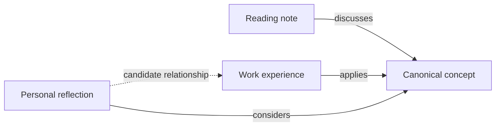

# ADR 0014: Keep one logical personal knowledge graph

- Status: Accepted
- Date: 2026-11-03
- Implementation: Partial; organisation and bounded retrieval delivered by later ADRs
- Documentation reviewed: 2026-11-07
- Refines: ADRs 0004, 0006, 0012 and 0013

## Context

Professional evidence was KNOT's first substantial collection. Its broader purpose
is to connect knowledge, experiences, observations, thoughts, beliefs, books,
concepts, ideas, hypotheses and questions across personal and professional life.
The user explicitly requires one interconnected knowledge system, with retrieval,
discovery and changes in understanding preserved over time.

## Decision

Maintain one logical RDF dataset with shared, explicitly resolved entity identities.
Keep named graphs for assertion identity, provenance and lifecycle. Files, source
schemes and specialised queries remain useful organisational boundaries, but do
not become independent personal, professional, reading or thought stores.

Retain local TriG, unchanged source revisions, disposable Oxigraph projections,
source-scoped mentions and confirmed canonical identity mappings. Preserve the
existing CLI, review workflow, competency schemes and viewer. A dataset-selected
competency framework governs its scoped definitions, not the entire knowledge vocabulary.

Distinguish the nature of a knowledge record from its origin, review and lifecycle.
An accepted thought remains a thought. A recorded observation is attributed and
contextual. A proposed relationship remains a candidate until explicitly reviewed.
Do not infer equivalence or causation from common names or shared concepts.

Treat retrieval and discovery as complementary operations over the same knowledge.
Retrieval returns existing relationships. Discovery proposes connections with
supporting evidence and rationale. Preserve source changes separately from changes
in a person's understanding.

AI assistants consult bounded, relevant context from KNOT. Keep the knowledge
useful without an LLM and defer MCP until retrieval and scoped access are tested.
This direction does not authorise new external model calls or expose private data.

## Illustration

The labels below illustrate relationships, not a fixed vocabulary. The dotted
connection is a proposed association, not evidence that a learning idea will work.

## Alternatives and consequences

Separate domain stores would make identity and traversal across domains harder.
One undifferentiated named graph would discard assertion boundaries without
improving connectedness. One logical dataset with explicit provenance retains
both connections and distinctions.

This refines the starting scope of ADR 0004; it does not discard its local-first,
assistant-access or Emacs goals. ADRs 0012 and 0013 continue to govern competency
definitions. ADR 0016 subsequently implements the small ontology and overlapping
themes requested as the first increment. Discovery rules remain proposed in ADR 0015.
ADR 0019 subsequently defines and implements the initial bounded context contract,
with independent evaluation pending.
