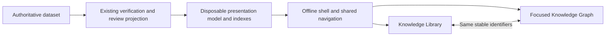
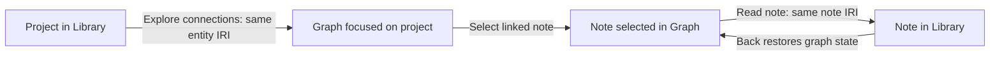

# ADR 0047: Explore one knowledge system through a library and a focused graph

- Status: Accepted
- Date: 2026-11-08
- Implementation: Implemented browsing release; browser authoring remains deferred
- Related: [0014](0014-one-logical-personal-knowledge-graph.md), [0022](0022-native-free-text-knowledge-and-entity-notes.md), [0026](0026-live-offline-graph-filters.md), [0032](0032-guided-zettelkasten-authoring.md), [0035](0035-notes-in-the-unified-graph.md), [0044](0044-extensible-visual-and-knowledge-themes.md), [0046](0046-guided-source-backed-curation.md)
- Supersedes: None. Adds a focused Graph entry screen and rich Library reading alongside ADRs 0026/0035; retains their identity, evidence and filtering contracts and the existing viewer.

## Context

KNOT provides one logical knowledge system containing native notes, imported sources,
entities, claims and separately reviewed organisation. The current offline viewer
puts the relationship network in the centre, filters on the left and reading/evidence
on the right. This works for inspecting connections, but the user reports that the
whole network becomes difficult to navigate as the collection grows. A graph is
also an indirect route to reading a note that has few or no connections.

The proposed interfaces answer complementary questions:

- **Knowledge Library:** What do I know?
- **Knowledge Graph:** How is it connected?

This is a presentation change. The native registry, immutable revisions and source
bytes, RDF assertions, identity decisions, provenance and review events remain
authoritative. The proposal creates no library database, alternative note store,
semantic ontology, separate relationship system, mandatory service or AI dependency.
It does not change the code/data repository split or require access to a Git remote
to browse a local export. Examples here are synthetic, not private dataset labels.

## Problem statement

Users need to find and read knowledge without arranging a network, follow several
organisational paths to one record, and move between prose and relationships without
losing their place. They also need to distinguish a connection made for navigation
from an assertion with evidence, qualifications and a review state.

Before this change, the implementation supplied much of the knowledge machinery,
but not these complete workflows. The following inventory records that baseline;
the implementation record below describes the delivered interface:

| Existing capability and implementation | Reuse and actual limitation |
| --- | --- |
| [Native notes](../src/knot/writing/notes.py): `list_notes`, `read_note`, `note_history`, immutable manifests and optimistic saves | Reuse identities, exact bodies and history. There is no interactive browser history reader or general browser editor. |
| [Native source adapter](../src/knot/writing/sources.py): `add_note_sources`, canonical associations, format, creation/modification dates and source eligibility | Reuse verified currentness and associations. The viewer's smaller payload currently drops format and dates. |
| [Graph export](../src/knot/presentation/visualise.py): `curated_notes(include_all=True)`, `add_note_navigation`, `add_claim`, `add_themes` | Already includes ordinary, curated and isolated current notes, incoming linked context, attributes and exact evidence. The graph's selected node set is not a complete library catalogue. |
| [Viewer filtering](../src/knot/presentation/viewer.js): `filterGraph`, `initialFilters`, search, one-hop focus and hop expansion/contraction | Reuse filtering semantics and traversal tests. Focus is initially unset; the PyVis page constructs the network immediately. Hiding its canvas would not avoid graph initialisation. |
| Viewer positions and inspector | Positions survive filtering and layout can pause. Per-branch expansion/collapse, a root-centred layout, a shared route/history and a reading-first screen need development. |
| Viewer note payload and `renderNotes` | Current bodies are embedded once and displayed as literal text with expandable citations. There is no Markdown/Org rendering, revision timeline or browser body search; sidebar search covers names, aliases, types and IDs. |
| [Note navigation](../src/knot/writing/navigation.py) and [notes guide](../docs/notes.md) | Saved links/reasons, themes and declarations can supply outgoing links, derived backlinks and entity context. They must not be converted into accepted claims. |
| [Theme catalogue](../src/knot/writing/themes.py), [definition validator](../src/knot/shared/theme_definitions.py), [organisation entries](../src/knot/graph/knowledge.py) | Overlapping themes and separate membership reviews exist. Theme definitions are flat and have no parent/subtopic field. Generated kind/type suggestions remain qualified. |
| [Source verification](../src/knot/retrieval_engine/evidence.py), [derivation](../src/knot/curating/provenance.py), [entity labels](../src/knot/curating/entity_labels.py), [evidence accounts](../src/knot/curating/evidence_accounts.py) | Reuse verified quotations, original and curated authorship, aliases and overlap qualifications. Similar names and repeated evidence do not establish identity or corroboration. |
| [Review replay and inspection](../src/knot/reviewing/state.py) | Current graph loading omits rejected/superseded domain triples. A correction/history panel requires an explicit historical projection; the active graph alone cannot reconstruct it. |
| [Styles and palettes](../src/knot/presentation/styles.py) and [viewer assets](../src/knot/presentation/viewer.html) | Reuse Matrix/Paper/Midnight and custom palette variables, responsive controls and literal evidence rendering. Readable typography and accessible contrast still require testing. |

The [architecture guide](../docs/architecture.md) correctly describes disposable
query projections, not a persistent search index or a transactional whole-dataset
snapshot. The export CLI is an owner-local operation; it currently has no scoped
export option. Browser filters are neither access control nor redaction.

## Decision drivers

1. Reading and finding notes should be useful before classification or graph enrichment.
2. Both views must address the same stable identities and verified revisions.
3. Organisation must tolerate overlap and ambiguity without inventing containment.
4. Provenance, review, origin, lifecycle and authorship must remain distinguishable.
5. Offline use and a portable artifact should remain available without a service.
6. Initial reading must not pay for laying out the entire graph.
7. Keyboard and assistive-technology users need equivalent routes to all content.
8. Prefer existing code and ordinary modules over a new application framework.
9. Leave a clear route to future authoring without building an editor now.

## Research and applicable interface patterns

The following primary documentation was checked on 2026-11-08. Observations are
limited to the cited features, not claims of complete product parity. The KNOT
applications in the final column are design proposals.

| Reference | Verified interaction | Application and boundary for KNOT |
| --- | --- | --- |
| Obsidian: [sidebars](https://obsidian.md/help/User%2Binterface/Sidebar), [backlinks](https://obsidian.md/help/plugins/backlinks), [local graph](https://obsidian.md/help/plugins/graph) | Two sidebars can hold navigation and context; linked and unlinked mentions are distinguished; local graphs follow an active note with configurable depth. | Use a central reader, optional context panel and selected-record graph. Do not turn name matches into saved links, or make filesystem folders the knowledge hierarchy. |
| Logseq: [networked thinking guide](https://blog.logseq.com/how-to-get-started-with-networked-thinking-and-logseq/) | Page links lead to linked references; referenced blocks have backlinks that can open in a sidebar. | Keep the originating context visible while following references. KNOT can use revision-pinned passages without replacing its note identities with a block store. Automatic creation of a page from a name is unsuitable for explicit entity resolution. |
| Roam Research: [official tools documentation](https://github.com/Roam-Research/roam-tools/blob/master/README.md) | The documented operations distinguish page/block backlinks, main-window navigation, right-sidebar navigation and left-sidebar shortcuts. | Separate selection from optional contextual reading. This verifies the navigation pattern, not a claim about Roam's graph layout or permissions. No Roam connector, AI integration or block database is proposed. |
| Notion: [linked database views](https://www.notion.com/help/guides/using-linked-databases) | Multiple filtered views present the same underlying content; view filters are local to a view. | Treat theme/type branches as views over canonical records. Do not adopt another database or a page nesting model as KNOT's authority. |
| Trilium: [notes in multiple tree positions](https://docs.triliumnotes.org/user-guide/concepts/notes/cloning) | A single note can appear in several tree locations without copying its content. | Give one KNOT note several navigation paths. Unlike an authored parent hierarchy, KNOT's initial paths are computed from existing memberships and explicit associations. |

For accessible navigation, W3C's [navigation tree example](https://www.w3.org/WAI/ARIA/apg/patterns/treeview/examples/treeview-navigation/)
warns that a full ARIA tree requires substantial keyboard behaviour; expandable
groups of links often suit the [disclosure pattern](https://www.w3.org/WAI/ARIA/apg/patterns/disclosure/examples/disclosure-navigation/)
better. Prefer semantic nested lists, disclosure buttons and real links initially.
If a desktop-style tree is chosen, implement the complete
[tree keyboard/focus pattern](https://www.w3.org/WAI/ARIA/apg/patterns/treeview/),
including virtualised item positions, rather than adding tree roles to ordinary lists.

## Considered alternatives

**Retain the current viewer only.** This has the smallest immediate cost and remains
a supported interface. Further filters alone would not supply a central reader,
virtual library, independent body search or shared reading history. It is the
compatibility baseline, not the recommended evolution.

**Option A: extend the offline HTML viewer.** One generated artifact contains a
Library and a Graph surface, backed by one presentation model. Reuse assets and
pure filtering code, but separate network construction from page startup.

**Option B: richer local web application.** A locally started application serves
read projections from existing Python APIs. It could fetch notes and neighbourhoods
on demand and later support writes. The APIs exist as Python/CLI/MCP contracts;
a browser HTTP API, server lifecycle and browser security boundary would be new work.
Keep static export available if this option is introduced later.

**Option C: separate specialised interfaces.** Independently launched Library and
Graph pages/apps coordinate through IDs and an agreed snapshot or API contract.
They still use the same dataset, but must reconcile navigation and artifact versions.

| Criterion | A: one offline artifact | B: local application | C: separate surfaces |
| --- | --- | --- | --- |
| Implementation complexity | Moderate: export model, reader and shared state; no server | Higher: same UI plus transport, lifecycle and access enforcement | Moderate initially; routing/version coordination adds work |
| Maintenance | One shell, model and release; renderer isolation needed | UI, Python service and protocol compatibility | Risk of duplicated controls, models and accessibility fixes |
| Offline operation | Open the file directly | Works offline while local process runs | Possible for two static pages; otherwise depends on their runtimes |
| Growing collections | Lazy DOM/layout helps; all embedded bytes still load | Can page bodies, indexes and subgraphs | Static variants retain the same load bound and may duplicate payloads |
| Data freshness | Explicit regeneration | Can reread current revisions and invalidate caches | Separate exports can disagree unless snapshot identity is checked |
| Search/filtering | Local metadata/body index over included records | Can reuse server-side retrieval and query current records | Search semantics must remain consistent across surfaces |
| Readability | Full reader is feasible in ordinary HTML/CSS | Equally feasible; service is not what improves typography | Specialisation is easy, but context switching is greater |
| Future editing | Requires an explicit write transport or CLI handoff | Natural extension, with explicit permissions and concurrency | Each surface must avoid implementing its own authoring rules |
| Portability | One self-contained artifact; no external assets | Requires compatible runtime and startup tooling | Multiple artifacts or installations must travel together |
| Security/access | Exported content is disclosed to the file holder; rendering must be safe | Localhost is not sufficient authentication; every request needs a defined boundary | More boundary and snapshot-consistency combinations to test |
| Architectural fit | Extends existing disposable projection and offline export | Fits only if it remains an adapter over existing owners | Fits the data model but complicates coordinated navigation |

**Recommend Option A for the browsing release**, with separate reader/graph modules
inside one shell. It is the smallest approach that meets the immediate requirements.
Reconsider B if measured payload costs or frequent freshness requirements defeat A;
do not add a service pre-emptively. Separate modules do not require separate products
as in C. No frontend framework or replacement graph engine is selected by this ADR.

## Proposed architecture

Use a **read projection**: a disposable presentation model derived from authoritative
records, never a second store that users edit. Build it independently of which nodes
the graph currently displays. Both surfaces resolve selections through that model.

The new shell defaults to **Graph View**, with a prominent **Library** button. Graph
View starts from an explicitly selected record, or offers a search/selection screen
when nothing is selected. It does not lay out the entire network on initial load.
The Library button opens the same selected record, or its search, All notes collection
and session recents when there is no selection. Explicit Library deep links and
Back/Forward still open their requested view. An explicit Full graph action remains
available within the export's limits.

The shell initially shipped through the additive `knot browse` entry point. Following
the owner's request for a single launch command, `knot view` and `just visualise`
now open the shared Graph/Library page by default; `knot view example` uses a disposable
synthetic dataset. Preserve the previous offline graph through `knot view --legacy`.
Both exporters share verified record construction
as it is extracted from the current exporter. Do not silently replace graph startup,
command-line filters or accepted-only behaviour while users are evaluating the library.

## Information architecture

### A virtual hierarchy, not containment

Offer these navigation roots without requiring users to classify anything:

| Root/path | Membership rule |
| --- | --- |
| All notes | Every eligible native note, including untitled, unclassified and isolated writing |
| Themes → theme → Notes → knowledge kind | Direct note theme membership; absent kind remains an explicit Unspecified group |
| Themes → theme → Projects/Concepts/other types → entity | Existing typed entities reached through that theme's note associations or active claim memberships; label the reason for inclusion |
| Entities → type → entity → Associated notes / Relationships | Existing identities and explicit associations; an untyped entity stays discoverable under Entity |
| Unclassified notes | Notes with no theme membership; not a quality failure |
| Standalone notes | Notes without exported note links, entity associations or claim connections; separate from Unclassified |
| Recently created / Recently modified | Native note timestamps, not filesystem mtimes or inferred event dates |
| Recently viewed | Navigation state from this browsing session, not knowledge metadata |

“Projects” and “Concepts” are filters over existing types. Do not guess a type from
a title or treat every Thought as a Concept. An entity may belong to several type
groups with its typing qualifications visible. A record without timestamps is not
given a fabricated creation date.

The initial **subtopics** are progressively narrower views: theme, record/type group,
then an existing entity and its explicit context. They do not assert that one theme
is a child of another. Additional theme intersections can narrow a branch. Automatic
grouping is agreed for the first release; manually arranged nested groups are deferred.
The current catalogue does not support those groups. Never derive parents from `relatedTo`,
common words, link direction or the position of a node on screen.

Native author-selected themes and inferred/reviewed assertion theme memberships
remain separate membership kinds. A project shown under a theme because of a claim
does not automatically assign that theme to every note about the project. Related
reading outside the branch can be offered under “Also associated”, with the reason
shown. Overlapping branch counts are not additive totals or independent evidence.

### Canonical identities and presentation occurrences

Each row carries the stable record IRI and a separate occurrence key for its virtual
path. The same note may appear under two themes and an entity, but has one record,
one current revision pointer and one body per revision in the export. Breadcrumbs
describe the route taken, not an authoritative parent. “Other locations” exposes
alternative paths to the same record. Same-label records keep distinct IDs.

Use the existing reviewed identity projection and preferred-label overlay for
entities. Retain source-scoped references and aliases; do not resolve identity by
title or combine a note with the subject it discusses. Literal attributes remain
values with datatype/language/units, not new entities. Evidence pins retain their
own provenance identities even when underlying bytes are shared.

Backlinks reverse the displayed direction of an existing saved note link for
navigation; they do not create another stored edge. Outgoing links, associations,
theme memberships and source-backed claims remain visibly separate sections.
Body text matches can appear in search results but do not become backlinks.

## Interaction design

### Knowledge Library

The left panel contains expandable collections, search, filters and recent views.
Populate expanded branches only, with paged results for large groups. Show the
current path and other memberships; allow moving between overlapping categories
without changing the selected record. Search results resolve to canonical records,
with title/alias matches ahead of body matches and a clear matching excerpt.

The centre is a reader with a constrained line length, adjustable text size, semantic
headings and generous paragraph spacing. Show the complete note title, optional kind,
author, current revision **as of this export**, and relevant entities. For curated
writing, distinguish its curator and qualification from each original source author.
Unknown authorship stays unknown. Provide rendered and exact-source text modes.
An entity opens an entity overview: name, aliases, qualified types, attributes,
associated notes and claims, without inventing a summary paragraph or empty note.

The right panel contains outgoing links, backlinks with their saved reasons, entity
associations, directional claims, source evidence and relevant corrections. Display
claim origin (Explicit/Inferred), review (including Unreviewed), and lifecycle
independently. Author-declared navigation has no claim acceptance badge. Theme review
does not change claim status. Repeated-account and unresolved-overlap qualifications
remain visible; sorting and grouping must not suggest corroboration.

A citation opens its pinned source revision and exact passage, independently of the
source's latest head. If the original binary/document is not embedded, say so rather
than implying that a quotation is the complete original. Keep source transcription
and original snapshot identities distinct. A current note edit does not silently
correct an older claim.

Offer a revision timeline from permitted metadata. Initially embed current note
bodies and historical bodies needed by included citations; mark other historical
bodies as not included and provide the existing CLI route to inspect/export them.
Do not label missing historical content as deleted. Export correction trails for
included claims from the historical review projection, retaining the replaced claim
and qualifications as history, not reintroducing it into the active graph.

On narrow screens, navigation and context become labelled drawers; the reader keeps
priority. The optional context graph is off initially and uses the same bounded
subgraph logic as Graph View. It must not start a second independent layout.

### Knowledge Graph

Open the selected note/entity at the centre with immediate eligible neighbours.
Keep a selected isolated record visible with an explanation, even when it has no
matching edges. Existing graph filters still govern connections; show why context is
hidden instead of silently resetting filters or fabricating links.

Reuse global +1/−1-hop controls, and add explicit expansion/collapse per node.
Track expanded nodes and recompute reachability: collapsing one route must not
remove a shared neighbour still reached through another expanded route. Cycles and
parallel claims retain their identities and cannot cause unbounded traversal.
Theme hubs and literal attributes remain context, not traversal shortcuts.

Use a deterministic root-centred spanning layout for positioning, with stable ties
by identifier and existing positions retained on expansion. This is a layout tree,
not a knowledge hierarchy. Preserve actual edge direction, relation labels and all
eligible cross-links. Show cross-links on selection or through an explicit toggle
when they clutter the display; report hidden counts and keep them in the relationship
list. Collapsing a branch changes view state only.

Reuse vis-network initially. Its [hierarchical layout](https://visjs.github.io/vis-network/docs/network/layout.html)
can be evaluated, but changes physics and edge options and does not establish that a
cyclic semantic graph is a tree. Compare a deterministic radial placement with a
bounded hierarchical layout before choosing the default. Avoid a new layout engine
unless the existing one fails measured readability and stability tests.

Preserve note identity/role distinctions, and add text/type badges or restrained icons
for people, projects, concepts and other supported types. Do not rely on colour alone.
Claims, note links and theme links keep separate visual meanings. Source evidence
remains in the inspector rather than becoming extra graph nodes; an actual Document
entity can still be a legitimate claim endpoint. Disable ongoing physics by default,
honour reduced-motion preferences, and expose every connection through a keyboard
accessible list as well as the canvas.

The owner subsequently requested the earlier moving graph alongside this focused
view. Offer **Focused** and **Live network** modes within Graph, sharing the same
model, filters, selection and Library. Live network explicitly opts into the full
graph and physics, with pause/resume and spacing controls; reduced-motion starts
it paused. Stop simulation while Library or the browser tab is hidden. Keep separate
positions/cameras for each mode. This introduces no live dataset service: both modes
still read the same exported snapshot.

Dense focused neighbourhoods can also overlap on radial rings. Provide an opt-in
**Live layout** button in Focused mode using the same physics controller, limited
to the visible subgraph. Pause retains the resulting positions; the spacing slider
adjusts either live forces or paused coordinates. Each mode remembers its motion
setting separately. Focused uses stronger repulsion and node-overlap avoidance to
give dense neighbourhood labels more room; full-network force settings are retained.
Focused stays paused by default, and switching to Library or
hiding the tab suspends either simulation. This trades perfect positional stability
while arranging for a way to spread crowded neighbours without loading the full
network; it does not guarantee a crossing-free or overlap-free layout.

## Shared selection, navigation history and view state

Define one selection as a stable IRI plus an optional explicit revision, with the
snapshot identity and object kind. A note used as a claim endpoint is still the same
note when opened in the reader. Routes use IDs, never labels or filesystem paths.

Use local URL fragments for deep links, with browser Back/Forward and an in-memory
navigation controller. Record navigation actions; use state replacement for transient
filter/zoom changes so a slider does not flood history. Restore the reader's scroll,
navigation branch, graph seed/expansions, filters and camera when returning to a view.
Both views share selection; view-specific filters are not blindly copied between them.

A claim-status filter in Library applies to the claims panel, not to the existence
of an unreviewed source note. The Graph retains its existing accepted-only rules.
When a route points outside graph filters, retain the reader selection and offer
an explicit adjustment. A record absent from the artifact gets “Not included in
this snapshot”, never a fallback to another record with the same label. An explicit
historical revision must not silently resolve to the latest version.

Recent views stay in memory for the first release and are never written into knowledge
data or persistent browser storage. Closing or reloading the viewer resets the list;
persistent recents are deferred. Any future opt-in persistence for recents/layout must
be scoped to the dataset, export boundary and presentation version. Invalidate caches
when the snapshot changes, then retain only still-present IDs; never carry source
text between scopes. File-URL storage cannot be a correctness dependency:
[MDN documents undefined `localStorage` behaviour for `file:` URLs](https://developer.mozilla.org/en-US/docs/Web/API/Window/localStorage).
Keep session-only operation available if future storage is unavailable. Provide a
clear-session control for KNOT's recent list; this does not erase the browser's own
history, which may retain deep-link IDs.

## Technical approach

### One export model with two renderers

Extract verified record construction into ordinary presentation-layer functions.
Keep note, graph, provenance and review owners unchanged. The first implementation
needs a versioned export contract, not a generic plugin architecture or a new database.

The model should contain:

- An export manifest: schema version, generation time, included filters/boundary,
  a snapshot fingerprint, record counts and explicit omissions.
- Records indexed by IRI: note headers (including format and timestamps), projected
  entities, qualified types/aliases and active assertions. Catalogue enumeration must
  include isolated notes and eligible declared entities, independent of graph edges.
- Revision/body and source maps, with exact hashes, authorship and derivation pins;
  share content once without merging note or evidence identities.
- Typed relations for claims, saved note links, associations and theme membership,
  carrying their owning record/revision and review semantics.
- Derived incoming/outgoing adjacency, facet memberships and search fields. These
  indexes can always be rebuilt; they are not another authoritative relationship set.
- Permitted revision metadata and the correction trails needed for included claims.

Use these same records in the reader and graph adapters. Adapt the current pure
filter functions rather than duplicating their semantic rules. The new HTML bootstrap
must delay `new vis.Network` until a record is selected in Graph View/local graph and
supply only the bounded neighbourhood, except for an explicit Full graph request.
The initial Graph search screen and a direct Library route require no graph layout.
The present PyVis template and global `nodes`/`edges`/
`network` assumptions require refactoring; embedding the old page in a hidden frame
would not meet the startup goal. Preserve the legacy exporter during that extraction.

### Readable markup without changing evidence

Markdown/Org rendering is new work. Prefer conversion at export time, so opening the
artifact requires no parser runtime, network or document execution. Keep exact original
text alongside its derived rendering; all source quotations and offsets refer to the
original text, never HTML positions. Unsupported syntax must remain inspectable in
source mode, not be silently dropped from the authoritative note.

Use sandboxed Pandoc as a separately installed export dependency because it supports both
[Markdown and Org input](https://pandoc.org/MANUAL.html#general-options). The existing
DOCX extraction helper already invokes Pandoc optionally, but the viewer does not
require it today. The agreed first-release design requires Pandoc to generate rich
Library snapshots, not to open them or use ordinary note APIs. This dependency is
implemented through the external converter. Separate parsers were considered but would add parser selection,
Org compatibility and maintenance work. Do not implement a broad markup grammar
with ad hoc regular expressions.

Pandoc is [GPL-2.0-or-later](https://github.com/jgm/pandoc/blob/main/COPYRIGHT).
Preserve KNOT's MIT licence by retaining the existing external-program boundary:
invoke the converter through its normal command-line interface with document text
as input and HTML fragments as output. Do not copy/link its implementation into KNOT
or bundle its binary in the first release. This design follows the GNU FAQ's
[distinction between separate programs and combined works](https://www.gnu.org/licenses/gpl-faq.html#MereAggregation).
Generate fragments inside KNOT's own page; do not assume converter templates or
embedded assets are covered by KNOT's licence. Conversion alone does not place the
user's notes under GPL; any copied program material has its own terms, as explained
in the [output guidance](https://www.gnu.org/licenses/gpl-faq.html#WhatCaseIsOutputGPL).
The existing [third-party notices](../THIRD_PARTY_NOTICES.txt) retain Pandoc's separate
licence and distribution boundary. Bundling Pandoc later would require satisfying
its distribution obligations and reviewing that changed packaging decision.

Define the initial supported rendering set: headings, paragraphs, lists, emphasis,
code blocks, tables and safe links. Org directives, includes and executable blocks
are not executed; raw HTML is escaped or rejected. Use fixed converter options,
resource limits and an allowlisted output/sanitisation boundary. Pandoc's
[security guidance](https://pandoc.org/MANUAL.html#a-note-on-security) makes clear that
sandboxing does not replace all output safety checks. No user-supplied filters,
templates or remote resource fetching are permitted. Disable external image loading
and arbitrary file links; outbound web links require deliberate activation.

Retain literal rendering for evidence and safe fallback/source mode. Escape inert
JSON correctly and test hostile titles, quotations, markup and URLs. Rendering a
body link does not add a stored note link; internal navigation requires an explicit
supported identifier, with unresolved targets clearly marked. The implementation
uses Pandoc's sandbox, fixed reader/writer options, an empty working directory and
a 15-second conversion timeout. Its HTML allowlist reserialises inert tags and safe
links, with exact-source fallback; tests exercise Markdown, Org, hostile input and
denied includes. Pandoc 3.1.3 is the tested converter version.

### Freshness, consistency and access

Show “Snapshot generated …”, the export boundary and a regenerate action/instruction.
A standalone file cannot know that the dataset changed; do not show an unsupported
“up to date” claim. Retain stable selection IDs when reopening a newer export, while
invalidating indexes and clearly distinguishing historical selections.

No whole-dataset transaction exists today. The proposed builder must enumerate all
mutable inputs it consumes, including registries, graph files, review events,
catalogues and identity/label overlays. Compare that input set and its signatures
before and after verification, while checking immutable bodies against their pins;
retry within a bounded policy or fail if inputs changed. Publish the completed
artifact atomically so an interrupted build preserves the previous valid export.
This is an export consistency guard, not a new transaction system for knowledge writes.

The first release remains an owner-local export. If restricted export is later added,
the existing access and transitive derivation checks must run **before** enumeration,
labels, counts, history, search indexes, source reads and serialisation. Do not claim
that the current owner exporter already enforces an MCP scope. A grant to a note
does not grant its linked notes or source closure. Clearing a filter cannot reveal
records excluded from an artifact. Anyone holding an artifact can read everything
embedded in it; previous copies cannot be revoked by changing a later grant.

### Future authoring

Keep selection/revision references available to a later command adapter, without
implementing an editor or write endpoint in the browsing release. Note creation,
optimistic `save_note(expected=...)`, navigation changes, theme definition changes,
candidate publication and explicit reviews must call their existing owners. Review
permission remains separate, and existing resumable multi-step publication remains
visible rather than presented as one atomic transaction.

Browser authoring would need a separately enabled local transport, explicit dataset
selection, authentication/origin and CSRF protection, and conflict handling. A trusted
local UI is not permission for arbitrary exported HTML to make writes. Option B can
be revisited for that requirement without changing the record model or requiring a
second database. Do not add a write endpoint just to future-proof a reader.

## Performance and scalability

Lazy rendering is not lazy loading: a self-contained HTML artifact still transfers
and parses its embedded content. Large histories, bodies and repeated quotations
can dominate memory even when the canvas contains only a few nodes. Deduplicate
payload references, mount only the active reader/context, and keep unexpanded
navigation branches out of the DOM. Page long lists before considering complex
virtualisation, whose focus and screen-reader behaviour must be tested.

Build incoming/outgoing indexes once per snapshot and cache eligible adjacency by
filter state. Expansion should inspect incident eligible edges rather than repeatedly
scan every edge for each hop. Start with metadata search and a bounded local body
index; search does not call an AI service or require Python in the browser. Profile
before introducing workers, persistent indexes or split-file loading. File-URL fetch
and storage restrictions must be tested before a multi-file export is proposed.

Keep a selected root and a proposed initial cap of **100 visible nodes and 300
connections**. If a neighbourhood exceeds it, show counts and an explicit paged
neighbour selector with stable ordering, including Unreviewed connections. Never
silently sample away relationships or treat an omitted edge as absent. Full graph
is opt-in and exempt from the bounded-neighbourhood timing target, not from clear
counts and semantic correctness.

### Proposed validation targets, not measured benchmarks

These were the provisional engineering targets before implementation. They remain
reference-machine targets, not universal device guarantees; measured results and
their limits are recorded below and in the performance guide.

| Operation | Proposed target on the recorded reference desktop |
| --- | --- |
| Initial Graph search screen or direct Library route ready | p95 ≤ 3 seconds for profile M; ≤ 5 seconds for profile L; zero graph layout starts without a graph selection |
| Metadata search / body search | p95 ≤ 200 ms / 500 ms after input debounce, on both profiles |
| Reopen a loaded note or switch views with retained state | p95 ≤ 150 ms, excluding first graph construction |
| First local graph or expand a bounded neighbourhood | p95 ≤ 1 second to visible stable content within the 100-node/300-connection limit |
| Rendering work | No ongoing physics while reading; at most 200 navigation result rows mounted per paged collection |

Use the agreed **synthetic** collection sizes: M has 1,000 notes, 3,000 entities and
10,000 claims; L has 5,000 notes, 10,000 entities and 50,000 claims. These are validation
targets, not hard storage limits or measured capabilities. Provisionally include
3,000 note links in M and 15,000 in L; finalise fixture details in Phase 0.
Use a published seed and body-size distribution (median 2 KiB,
maximum 100 KiB), overlapping themes, isolated notes, duplicate labels, citations,
corrections and at least one high-degree hub. These are synthetic validation targets,
not counts measured from private data. The scale fixture measures collection loading,
search and a high-degree graph; the smaller shared example fixture separately checks
real authoring, citations, corrections and revision history through existing APIs.

Desktop and laptop browsers are the agreed primary targets for the first release.
Keep responsive reading/navigation and accessibility checks on smaller viewports;
phone-specific graph refinements and mobile performance guarantees are deferred.
Choose reference desktop/laptop hardware in Phase 0.

Record hardware, OS, browser/version, CPU throttling, payload bytes and peak memory.
Use at least 20 cold opens and 50 warm actions per profile; retain raw runs and p95,
not only favourable averages. Run Chromium and Firefox, plus narrow-viewport/manual
keyboard and screen-reader sessions. Define exact timing marks and an export size/
memory budget after establishing the baseline, before implementation acceptance.

Reuse [viewer fixtures](../tests/viewer_fixture.py),
[browser checks](../scripts/test_viewer_browser.cjs) and the
[existing benchmark harness](../scripts/benchmark_viewer.cjs) where applicable.
At design time that harness instrumented the PyVis constructor and graph interactions;
its layout/FPS results did not establish Library performance. Implementation added
the [Library benchmark](../scripts/benchmark_library.cjs) and
[browser checks](../scripts/test_library_browser.cjs); the
[performance record](../docs/library-performance.md) describes measured coverage and
remaining limits, including unmeasured live-layout settling. If representative
profiles miss agreed startup/memory targets after deduplication and bounded rendering,
document the limiting resource and reassess optional local serving before scaling A
through increasingly complex browser caches.

## Trade-offs and risks

| Risk | Proposed treatment |
| --- | --- |
| A tree implies ownership or conceptual parenthood | Label virtual groups and membership reasons; never infer containment from general relationships. |
| Suggested classifications look authoritative | Show type/membership origin and review separately; retain unclassified records and explicit note selections. |
| A layout tree hides cycles/cross-links | Keep canonical nodes and actual directions, expose cross-links and omission counts, and provide a full relationship list. |
| Stale or inconsistent exports | Show generation/boundary information, require regeneration and verify input consistency before atomic publication. |
| Large artifacts and histories | Deduplicate content, bound rendering, declare historical-body omissions and measure payload/memory before adding infrastructure. |
| Rich markup weakens the current literal-text safety | Sandbox conversion, constrain supported syntax, sanitize derived rendering and retain exact-source mode. |
| Two renderers diverge semantically | Share one record/index contract and navigation controller; test the same IDs, claims and evidence in both views. |
| Accessibility gets deferred to polish | Treat keyboard alternatives, focus, reflow, reduced motion and semantic status labels as Phase 1 requirements. |
| File-based routes/preferences vary by browser | Use fragment navigation, test it on supported browsers, and make storage optional rather than authoritative. |

## Consequences

The Library makes isolated writing useful and gives a direct reading path through
existing knowledge. The Graph remains valuable for spatial exploration, with less
initial clutter. Multiple category paths preserve one identity, while shared state
reduces the cost of switching between reading and exploring.

The cost is a larger presentation layer, a new export contract, markup safety work
and broader accessibility testing. Snapshot regeneration remains necessary. The
first release cannot offer live history loading, unbounded collections or browser
editing merely by rearranging the current page. Maintaining the legacy viewer during
migration also has a temporary compatibility cost; share verification and tests to
keep that cost bounded.

## Implementation phases

The user authorised implementation after resolving the interface choices below.
This sequence records the delivery plan. The browsing release implements the shared
model, Library, Graph and core refinement work; authoring and further validation
remain explicitly separate. No personal claim review or access changes were authorised.

| Phase | Deliverable and exit gate |
| --- | --- |
| 0 — Contracts and feasibility | Finalise the record/export contract, markup strategy, history boundary and measurement environment. After implementation approval, prototype sanitised Markdown/Org reading and delayed graph construction with synthetic data. Ratify budgets and test fixtures; preserve existing viewer regressions. |
| 1 — Library and shared navigation foundation | Build the Library surface, virtual collections, metadata/body search, readable notes, entity context, backlinks, citations and essential correction/history context. Include canonical selection, fragment routes, Back/Forward and accessible responsive navigation from the start. Direct Library startup must create no graph; this development milestone precedes the integrated release. |
| 2 — Graph entry and two-way exploration | Ship the integrated shell opening in Graph View with a clear Library button. Connect Explore connections and Read note using the shared selection. Reuse current one-hop/hop controls in a lazily constructed bounded graph, with search/selection before layout when no record is selected. Preserve each view's filters, scroll, camera and return path; show missing/filtered context explicitly. |
| 3 — Focused graph refinement | Add per-node expansion/collapse and compare root-centred layouts. Preserve shared neighbours, direction, parallel claims, cross-links and stable positions under the agreed limits. Keep the full graph available explicitly. |
| 4 — Scale and usability refinement | Measure the representative profiles, refine search/paging, accessibility and rendering costs, and decide whether optional local serving is justified. Accessibility and core bounds are already release gates, not work postponed until this phase. |
| 5 — Separately proposed authoring | Evaluate creation, revision, link/theme editing and review controls through existing APIs, with explicit write permissions and conflicts. Select a transport only when the browsing experience is established. |

This revises the suggested sequence by moving the shared identity/navigation contract
and basic performance/accessibility work into Phase 1. Deferring those would make the
first Library a disconnected interface requiring a later rewrite. The more advanced
graph layout work can follow because one-hop and multi-hop exploration already exist.

## Acceptance criteria

1. Opening the new artifact without an explicit route shows Graph View and a clear
   Library button. Without a selection, show search/selection without graph layout;
   with an explicit graph selection, show its bounded neighbourhood. Library deep
   links open the reader directly. All eligible notes, including an untitled isolated
   note, are reachable in the Library without requiring graph interaction.
2. A note in two themes and one entity's reading list opens the same IRI and revision
   from every path; one selection and one stored body serve all occurrences.
3. Missing theme/type/kind/relationship metadata does not prevent browsing. A cycle
   of `relatedTo` claims never becomes a stored or displayed containment hierarchy.
4. Selecting a project, exploring its graph, following a note and opening it in the
   Library preserves identity. Back/Forward restores each view's context. Identical
   labels cannot substitute one record for another.
5. A standalone selection remains visible in Graph View. Hop and branch controls
   respect filters and caps, preserve other open paths, and report hidden neighbours.
6. Markdown and Org fixtures render the agreed syntax readably; exact-source mode
   and citations preserve bytes/hashes/locators. Hostile text executes nothing and
   causes no network requests, arbitrary file reads or authoring actions.
7. Backlinks reflect saved note links. Body matches, associations and theme navigation
   never appear as accepted factual relationships. Review, origin and lifecycle remain
   separate, and accepted-only Graph semantics remain covered by existing regressions.
8. A citation can show an older source revision without changing the note's current
   head. Curated and source authorship, qualifications, correction trails and repeated
   evidence remain distinguishable. Non-exported history is labelled as such.
9. Regeneration updates the manifest's generation time; changes to included inputs
   change the snapshot fingerprint. An interrupted or concurrent build cannot replace
   a valid artifact with a mixed or partial one. An old file always identifies itself
   as a snapshot, not a live view.
10. All browsing/evidence tasks work without canvas interaction. Test keyboard focus,
    visible focus indicators, labels, contrast, reduced motion, 200% zoom and a 360 px
    viewport, using [WCAG 2.2](https://www.w3.org/TR/WCAG22/) as the accessibility target.
    Automated checks alone do not establish conformance.
11. Agreed profile/timing/payload budgets pass with recorded results and omissions;
    no claimed benchmark relies on private data or an unbuilt interface.
12. Existing viewer (`knot view --legacy`), note/provenance/review tests and offline browser checks remain
    supported. Export and navigation leave authoritative file hashes unchanged. Any
    future restricted export proves non-disclosure in metadata and indexes as well as
    visible content before being described as access-controlled.

## Confirmed decisions

- **First-release freshness:** Use offline snapshots, as agreed during review. Library
  and Graph share the same generated snapshot. After knowledge changes, regenerate
  the artifact and reload it to see those changes. Show the generation time; a live
  local application is outside the first-release scope. This resolves the freshness
  choice without accepting the remaining proposal or authorising implementation.
- **Rendering dependency and licence:** Use separately installed Pandoc for rich
  Library export, conditional on preserving KNOT's MIT licence. Invoke it as an
  external converter with the boundary above; do not bundle its implementation or
  binary. Opening a snapshot needs only a browser. Rendering/security validation
  remains required before implementation is accepted.
- **Library organisation:** Generate navigation groups automatically from existing
  themes, types and explicit associations for the first release. Preserve overlapping
  memberships and standalone/unclassified notes without duplicating identities or
  inventing classifications. Manually arranged nested groups are deferred.
- **Snapshot history:** Include permitted revision metadata for the timeline, current
  note bodies and historical bodies needed by included citations in the first release.
  Clearly mark other historical bodies as not included. All authoritative history
  stays preserved in the dataset; an optional full-history export is deferred.
- **Recently viewed:** Keep the list in memory for the current viewer session only.
  Closing or reloading the viewer resets it. Do not persist it in browser storage or
  the dataset; remembering recent views between sessions is deferred.
- **Primary devices:** Target desktop and laptop browsers for the first release.
  Retain responsive reading/navigation on smaller screens; defer phone-specific
  graph refinements and mobile performance guarantees. Select reference hardware
  before measuring acceptance targets.
- **Collection sizes for validation:** Test synthetic collections of 1,000 notes,
  3,000 entities and 10,000 claims, and 5,000 notes, 10,000 entities and 50,000 claims.
  These are agreed test sizes, not storage limits or proven performance. Detailed
  fixtures, reference hardware and timing/payload budgets still need Phase 0 validation.
- **Default view:** Open the new interface in Graph View with a prominent Library
  button. Retain focused exploration and search/selection before layout when no
  record is selected; opening Graph does not load the full network. Honour explicit
  Library links and navigation history. Keep the existing viewer supported during
  migration.

## Open decisions

The user-facing choices are resolved. Continued validation and future enhancements
remain separate from the delivered browsing interface.

| Technical decision | Next step |
| --- | --- |
| Additional converter/browser versions | Extend the tested matrix before promising support beyond the recorded versions. |
| Broader hardware, memory and accessibility validation | Test additional desktops/laptops and assistive technology; sampled JS heap is not peak browser memory. |
| Alternative static graph layout and optional context mini-graph | Revisit if radial placement with optional live arrangement and the main local Graph prove insufficient; neither changes knowledge semantics. |
| Browser authoring | Requires a separate transport, permission and concurrency design. |

## Implementation record

`knot view` and `just visualise` package a verified owner-local snapshot and open one
browser tab in Graph View with a Library button. `knot browse` remains available for
export without launching. Shared IDs and session state connect virtual collections, body
search, rendered/source reading, outgoing links, backlinks, current/cited revisions,
entity context and qualified claims. An isolated note needs no relationship to be
read or selected in Graph View. Graph construction waits for a record selection or
an explicit choice of Live network.

The application remains a modular monolith. Python separates snapshot construction,
markup conversion, packaging and browser launch. Browser modules separate the pure
model/search/traversal functions, DOM helpers, reader, graph adapter and shell.
The legacy viewer shares note construction and graph filter semantics. See the
[module ownership table](../docs/architecture.md#library-and-graph-module-boundaries).

Focused mode starts with deterministic radial rings and preserved coordinates.
Its opt-in Live layout and the full Live network reuse the same vis-network instance
and separate layout module. Each mode preserves its own motion setting, positions
and camera.
The shared spacing slider scales static positions around the centre without changing
the camera or enabling physics, preserving manual placement. It also applies to
paused networks and cached layouts when switching modes.
Both modes expose ADR 0035's **Associated notes** toggle through the shared graph
filter module. It hides navigation-only notes without suppressing claim endpoints,
changing review state or filtering Library reading. The explicit focused root is
retained even when its other connections are hidden.
This meets stable-placement and cycle requirements without a layout engine
change or hierarchical constraints that could suggest containment. Hop and branch
controls retain shared neighbours, cap visible content and report omissions; the
connection list supplies keyboard navigation and access to omitted neighbours.

[Public synthetic examples](../data-examples/README.md) generate a disposable dataset
through the normal authoring APIs, shared by demonstration and browser tests.
Example-only startup metadata selects a connected project so the demo immediately
shows relationships; ordinary exports still wait for selection. Explicit routes
override that starting record. An isolated example remains independently readable.
Separate deterministic browser-scale fixtures cover the agreed M/L sizes without private data.
The [performance record](../docs/library-performance.md) distinguishes actual measured
results from proposed targets and records the remaining validation limits.

## Documentation verification

This proposal was checked against the implementation and ADRs listed above, the
[notes](../docs/notes.md), [viewer](../docs/viewer.md),
[organisation](../docs/organisation.md) and [architecture](../docs/architecture.md)
guides, and the storage/provenance policies in [AGENTS.md](../AGENTS.md).
Relevant reusable regression suites include [viewer export](../tests/test_visualise.py),
[curated evidence display](../tests/test_curated_viewer.py),
[note navigation](../tests/test_note_navigation.py),
[native retrieval/access](../tests/test_native_retrieval.py) and
[browser filtering](../scripts/test_viewer.cjs).

Implementation adds presentation code, tests, synthetic examples and documentation.
No authoritative personal knowledge, grants, storage schema or dependency licences
are changed. Browser editing, persistent recents and manual topic nesting are deferred.
