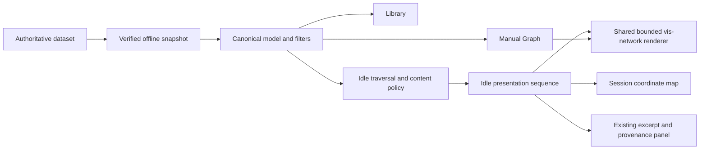
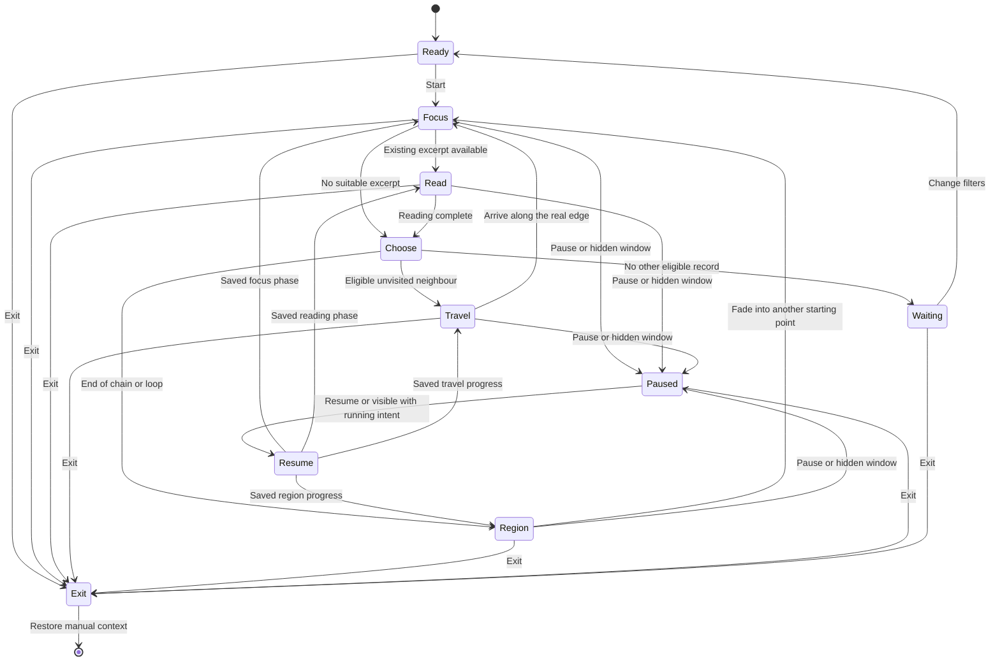

# ADR 0048: Cinematic exploration of existing knowledge in Idle

- Status: Accepted
- Date: 2026-11-09
- Implementation: Implemented; real-time soak and physical second-monitor validation pending
- Extends: [0047](0047-unified-knowledge-library-and-graph-exploration.md)
- Related: [0014](0014-one-logical-personal-knowledge-graph.md), [0022](0022-native-free-text-knowledge-and-entity-notes.md), [0026](0026-live-offline-graph-filters.md), [0027](0027-source-preserving-knowledge-curation.md), [0028](0028-meaningful-entity-names-and-value-presentation.md), [0029](0029-semantic-integrity-and-explicit-identity-resolution.md), [0030](0030-continuous-knowledge-curation.md), [0035](0035-notes-in-the-unified-graph.md)
- Supersedes: None. This refines the Idle decision; Library, Graph and the legacy viewer remain supported.

## Context and problem

Library allows deliberate reading; Graph allows deliberate exploration. Idle lets
existing knowledge reveal itself on a second monitor without requiring a question.
It is launched manually, independently of inactivity detection.

The initial Idle implementation reused the correct offline model and canonical
identities, but replaced neighbourhoods before a short camera interpolation. Its
200-coordinate cache could also move a previously visited record after eviction.
An immediately visible card and a 1.2-second transition felt like changing graph
screenshots. The required experience is a continuous map: observe a node, read its
knowledge, travel along a real connection and gradually reveal its surroundings.

This refinement updates the same ADR and presentation modules. It does not change
storage, source verification, assertion review, identity resolution or authoring.
The requested visual reference is a nearly black canvas with fine emerald lines,
restrained node glows, readable labels and generous spacing. It supplies no knowledge
content or permission to invent connections.

## Decision drivers

- Continuous spatial geography and calm, deliberate movement.
- Reading existing knowledge with its attribution and qualifications.
- Explicit distinction between following a relationship and changing regions.
- Bounded rendering, no continuous physics, and interruption without snapping.
- Offline portability, one authoritative dataset and existing access boundaries.
- Exact restoration of the user's manual navigation context.
- Small modules and browser validation using the existing renderer.

## Decision and architecture

Retain **a dedicated Idle presentation controller over the shared model and
vis-network renderer**. Use a state machine for the presentation sequence. Traversal,
geography and playback remain separate from DOM controls and manual navigation.

Reuse the actual implementation:

| Component | Responsibility |
| --- | --- |
| `library_snapshot.py`, `note_records.py` | Verified notes, current revisions, deduplicated bodies, canonical associations, source metadata, active claims and corrections. |
| `library.py` | A self-contained HTML artifact with bundled assets and export signature checks. |
| `library_model.js`, `graph_filters.js` | Canonical indexes, filtered adjacency and bounded neighbourhoods; no theme-hub shortcuts. |
| `library_idle_model.js` | Content descriptors, chain traversal, components and a cancellable phase clock. |
| `library_idle_scene.js` | Easing, incremental geography and neighbourhood unions; no authoritative graph data. |
| `library_idle.js` | Focus, reading, travel and restart sequence; controls and exact source handoff. |
| `library_graph.js` | One shared renderer, incremental DataSet changes and camera transforms. |
| `library_graph_style.js` | Manual and Idle style strategies, including per-record fades. |
| `library_navigation.js` | View switching, browser history and saved manual context. Automatic visits bypass normal navigation. |
| `library.js` | DOM composition and callbacks for capturing/restoring manual controls and reader state. |

[ADR 0049](0049-explicit-workflow-and-presentation-boundaries.md) records the
navigation and styling extraction without changing this presentation contract.

No new framework, service, AI dependency, relationship system, ontology, persisted
layout or second knowledge store is introduced.

## User experience and presentation sequence

Primary navigation remains **Library | Graph | Idle**. Entry shows Start and the
inherited filters. Browser Forward and a direct Idle route open ready, without
silently starting. Automatic steps never append history or Library recents.

The default sequence is:

1. **Focus — 10 seconds.** Compose around the selected node at a fixed zoom. Its
   glow increases gently during the first 1.4 seconds, included in the focus period.
   Nearby real connections remain visible. The knowledge panel is absent.
2. **Reveal and read — 10 seconds.** Fade in the panel over 0.8 seconds, then retain
   it for the full configured reading duration. Show a complete existing excerpt,
   actual author or curator, source reference and qualifications. Preserve line
   breaks. A node without suitable text skips this stage, not its graph connections.
3. **Choose.** Select one real adjacent edge according to the traversal policy.
   Fade out the panel over 0.8 seconds. If the destination was omitted by the scene
   cap, reveal that endpoint and its real connecting edge before departure.
4. **Travel — 24 seconds.** Emphasise that edge and move the camera from the source
   coordinate to the destination coordinate using smooth quintic easing. Use fixed
   zoom and fixed endpoint coordinates. Neither node changes location.
5. **Reveal the destination neighbourhood.** During the latter part of travel,
   fade in previously unseen neighbours while old peripheral nodes fade away.
   Keep shared nodes and both journey endpoints visible. Commit the destination
   only on arrival, then begin its focus period.

Focus supports 3/5/10/20/30 seconds, reading 10/15/20/30/60/120 seconds and travel
4/12/24/40 seconds. Settings apply when the corresponding phase next starts.
Reading duration excludes fades; travel duration excludes panel dismissal and any
pre-departure reveal. These are product defaults, not measured performance claims.

Pause and hidden-window suspension freeze the current frame and remaining phase
time. Resume continues from that point, including mid-journey; it does not rewind to
the last node or skip to the destination. Visibility does not override an explicit
pause. Exit cancels all work. Delayed callbacks carry cancellation tokens; slow
animation frames do not cause a catch-up jump after machine sleep.

## Geography and progressive rendering

Keep one coordinate per discovered canonical record for the entire Idle session,
bounded by the snapshot's record count. Do not evict coordinates after 200 visits.
Clear this map on Exit. Manual Graph coordinates remain in the saved return context.
The geometry is navigation-dependent session state, not a semantic hierarchy or a
claim about conceptual distance. A new session may start with a different geography.

Place newly discovered nodes in free cells around an already placed neighbour,
using stable identifier ordering and a deterministic slot preference. A sparse grid
keeps node centres and ordinary labels apart. Never move an existing coordinate to
make space. Separate starting regions can use distant map origins because transitions
between them do not pretend to trace a connecting path. Long labels and dense cycles
can still overlap; this is not a global crossing-minimisation layout.

A settled neighbourhood contains at most **20 records and 40 edges**, one hop by
default or optionally two. During travel, retain the union of departure and arrival
neighbourhoods, bounded by **40 records and 80 edges**. Both endpoints are reserved.
Any omitted next endpoint is revealed before departure; the shared edge/endpoints
keep that union within the same bounds. Omission counts remain available.

The old scene is not removed at departure. New records enter at zero opacity;
source-only context fades down as destination-only context fades up. Shared records
keep their coordinates and opacity. Remove old records only after their fade has
finished. A fixed zoom prevents repeated fitting from shrinking the map to an
unreadable full network. Offscreen geography is allowed; graph layout is not an
attempt to fit every neighbour into the viewport.

The bundled vis-network renderer supports
[viewport transforms](https://visjs.github.io/vis-network/docs/network/#methods),
[node opacity and shadows](https://visjs.github.io/vis-network/docs/network/nodes.html)
and [edge colours and opacity](https://visjs.github.io/vis-network/docs/network/edges.html).
Use these capabilities through incremental DataSet updates. Idle edges are straight,
so the camera follows the same segment as the highlighted relationship. Preserve
arrow direction and navigation/inference dashes; show the selected relationship's
meaning, origin and review status in semantic HTML. Parallel edges may overlap;
the caption retains the actual chosen edge's identity and meaning.

Idle uses a nearly black background, small softly glowing nodes, a brighter focal
node and thin emerald edges. Most edge labels are withheld to reduce clutter; the
active edge and its caption explain the journey. The dark translucent reading panel
sits beside the focal composition. This dedicated presentation palette does not
replace Library or Graph theme settings. No particle effects or ongoing physics run.

## Traversal and termination

Use `eligible(filters)` from the same model as Graph. Only included canonical
records and active eligible relationships can be stops or steps. The manual Graph
exception that preserves a filtered-out selected root does not apply to Idle.

Saved note links, declared associations and source-backed claims are eligible.
Traverse either direction for navigation while retaining the original arrow and
subject–predicate–object description. Reverse movement never asserts an inverse.
Literal attributes supply reading context, not destination nodes. Theme membership,
provenance and historical claims do not create traversal shortcuts.

Start from the manual selection if eligible. Otherwise prefer a connected record
with readable content, favouring curated notes. Nodes without an excerpt remain
traversable and show their actual labels and relationships without invented prose.
This replaces the original content-only stop restriction, which broke real chains.

After each stop:

- Exclude self-links and records already visited in the current chain. Group parallel
  edges by target so duplicate evidence does not multiply selection probability.
- Prefer a destination already visible. Among candidates prefer explicit note links
  and Explicit Accepted claims, then declared associations, then other allowed claims.
- Within a tier prefer destinations outside the last 12 stops, curated content,
  readable content, fewer visits and lower degree. Use session-seeded ties.
- Follow one actual relationship. Two-hop display never creates a two-hop shortcut.

There is no arbitrary step limit. At a fork choose one branch; at a dead end or a
continuation that would loop, start another chain. Prefer a nonrecent stop in another
eligible component, otherwise another starting point in the same component. If all
alternatives are recent, hold once more before replaying the least recently visited
alternative. Reset the chain visited set at this boundary. The chain set is bounded
by the snapshot, not by elapsed running time. Recency never breaks an otherwise valid
continuation in a newly started chain.

Region changes fade the old canvas to darkness, switch position while invisible,
then fade in the new region over four seconds. They are labelled **New region** or
**New starting point** and have no connecting line. Components refer to the filtered
snapshot, not a claim that the full knowledge base is disconnected. A singleton
completes its focus/reading sequence and waits without further timers. An empty
selection explains that no records match and leaves the filters available.

## Existing content, provenance and access

For a note, use its current included body. For an entity, prefer a curated note from
its explicit association index, otherwise an associated authored note. Never attach
text by a matching label. Fallback to a complete pinned passage from an eligible
active claim, with the named relationship and its origin/review state. No excerpt is
required to pass through a genuine graph node.

Take a whole introductory text unit from already sanitised rendered content, retaining
line breaks and qualifications. Excerpt plus qualification must fit 1,200 characters;
skip reading if no complete suitable unit fits. Do not cut off negation, invent a
summary, combine passages into new prose or claim the excerpt represents the whole
source. Mechanical selection cannot establish semantic sufficiency. Label partial
material as an excerpt and offer the exact included revision in Library.

Preserve curator versus original authorship, source references, review state and
known evidence qualifications. Associated notes remain reading context even when a
relationship filter hides their navigation edge. Accepted-only hides authored
navigation; it never marks a note as an Accepted claim. Filters apply before choosing
steps and before choosing claim fallbacks. Inferred and Unreviewed claims remain
explicitly labelled. Corrections and identity decisions use the existing reader.

The feature never writes notes, assertions, reviews, identities or grants. It uses
only the embedded snapshot and never fetches linked sources, another dataset or
external APIs. The current export is owner-local and discloses every included byte
to its holder; theme filters and full screen are not access controls. A snapshot
remains stale until regenerated. Scoped export remains separate architectural work.

## Controls, accessibility and restoration

Provide Start/Pause/Resume, Full screen, focus/reading/travel timing, one/two hops,
existing relationship/theme filters, Open another window and Exit. Mouse movement
never exits or pauses the tour. A visible second-monitor window continues even when
another application has focus; a hidden/minimised document suspends work.

Space toggles playback outside interactive controls. Tab reaches every control and
source action. Focusing the knowledge panel pauses reading. Never move keyboard focus
on an automatic transition. Reduced motion keeps focus and reading stages but replaces
camera travel, fades and zoom with discrete updates. A changed preference can finish
the current animation immediately. Preserve prose and relationship descriptions as
semantic HTML rather than canvas-only text; avoid per-frame live announcements.

Full screen requires a deliberate button action. Denial leaves an ordinary usable
window. Escape exits full screen first, then Idle when outside full screen. Open
another window links to the same artifact with the current filters and no opener;
the new window starts ready. The user chooses the monitor. There is no automatic
monitor-placement permission, operating-system wake lock or cross-window state sync.

Save the Library/Graph route, pinned revision, search, collection, expanded branches,
scroll, focus, recents, filters, coordinates and camera on entry. Exit/Back restores
that context. A deliberate **Pause and read source** action instead opens the exact
shown revision. Automatic visits never enter manual history or persist coordinates.

## Performance and resource constraints

Reuse one graph instance and its DataSets. Request animation frames only during
brightening, fading or travel; focus and reading holds use a single timeout. Freeze
all scheduled work when hidden or paused. Do not run continuous force simulation or
reconstruct the graph object on a visit. Filter/depth changes cancel the sequence,
rebuild the eligible projection and begin a fresh focus stage.

Retain one descriptor and visit entry per record, one coordinate/occupied cell per
discovered record, 12 recent stops and the current chain set. Rendering and transition
state remain bounded by 40/80. Release them on Exit. Full snapshot loading, component
indexing and coordinate memory remain O(V + E); no claim of unlimited scale is made.
Dense placement and long labels need measurement, not a new layout engine by default.

## Alternatives and trade-offs

| Approach | Assessment |
| --- | --- |
| Add timers to manual Graph | Small patch but mixes automatic selection with history, recents, physics and manual coordinates. Does not address continuous geography. |
| Dedicated Idle controller with shared renderer | Chosen. Existing canonical data, camera transforms and incremental drawing support the sequence; separate state permits exact pause and restoration. Costs per-record geography and explicit transition tests. |
| Custom SVG/canvas renderer | Offers finer label/edge choreography but duplicates arrows, styles, geometry and renderer maintenance. Reconsider only if measured renderer limits prevent the required experience. |
| New UI framework or graph engine | No demonstrated need. Adds packaging, licensing and maintenance work to an offline artifact. |
| Retain the initial scene-changing Idle view | Simpler memory bound but violates stable geography and slow continuous travel. |

Positive consequences: real connected exploration, readable source-backed ideas,
stable revisits, no authoring side effects and offline portability. Costs: more
presentation states, bounded per-record coordinate memory, visible bias from traversal
priorities, incomplete neighbourhoods around hubs, possible label/cross-link overlap,
and stale snapshots. The view is not exhaustive retrieval or proof of causal meaning.

## Incremental delivery and acceptance

1. Preserve existing identity/filter/content tests; add missing-excerpt bridges,
   long chains/cycles and revisits after more than 200 discovered nodes.
2. Add retained coordinates and a phase clock that freezes the actual rendered state.
3. Add focus/read timing, shared-scene travel, progressive fades and the dark palette.
4. Validate in browsers against synthetic chains, cycles, hubs, isolated records and
   disconnected components; retain Library/Graph restoration tests.
5. Complete physical second-monitor, assistive-technology and extended soak checks.

Acceptance requires observable behaviour:

- The panel stays absent through approximately ten seconds of focus, then remains
  readable for the configured reading period before movement.
- Camera coordinates occupy intermediate points on a real connection during the
  default 24-second journey; actual canvas positions change at a constant zoom.
- Existing world coordinates remain unchanged before, during and after travel and
  revisits. Source and destination stay in the scene; no force simulation runs.
- New-neighbour opacity increases and old-neighbour opacity decreases across sampled
  browser frames; old nodes disappear only after their fade completes.
- Several successive real edges are traversed. Content-free bridge nodes skip only
  reading. Loops terminate and disconnected components fade without a fabricated edge.
- Pausing mid-journey freezes camera and fades; resuming continues the same progress.
  Hidden documents suspend, reduced motion works, and Exit restores manual context.
- No rendered frame exceeds 40 nodes/80 edges; histories and coordinate maps do not
  grow beyond their specified snapshot bounds. No outbound HTTP request or data
  mutation occurs.

Automated validation lives in `scripts/test_library.cjs`,
`scripts/test_library_browser.cjs`, `scripts/test_idle_browser.cjs` and the existing
Python suite. Browser checks inspect actual renderer coordinates, camera transforms,
per-record opacity, semantic text and screenshots, rather than only timer calls.
See [the validation record](../docs/library-performance.md#idle-validation).

An eight-hour real-time soak, physical monitor/full-screen behaviour, screen-reader
review and frame/heap profiling on representative hardware remain unmeasured. Record
hardware, browser, snapshot size and observations before setting performance budgets.
No invented FPS, memory or long-session benchmark is asserted. If measured problems
remain, first adjust scene density and placement before replacing the renderer.
