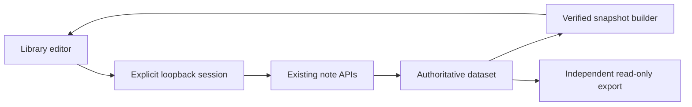

# ADR 0050: Write ordinary notes from an optional local Library

- Status: Accepted
- Date: 2026-11-09
- Implementation: Implemented
- Connections and themes increment: 2026-11-10
- Extends: ADRs 0022, 0032, 0047 and 0049
- Preserves: ADRs 0027–0030 and 0048

## Context

Library, Graph and Idle share a verified read projection. The owner authorised the
next increment: create an ordinary note, read it, edit its title/body and save it
without leaving Library. The existing note APIs already preserve immutable history,
authorship, navigation and optimistic concurrency. Exported HTML cannot itself be
an authority to write a dataset.

## Decision

Add `knot serve`, an explicitly started owner-local application over one selected
dataset. Reuse the existing viewer and authoring APIs. Keep `knot view`/`browse`
as independent read-only exports; neither command starts a service. No new library,
database, framework, AI provider or mandatory service is introduced.

The editor creates Markdown/Org notes and edits ordinary native notes' title,
body, explained note links and existing theme memberships. A new note may name its
author; an edit retains existing authorship, format, kind, associations and entity
declarations. Record the saving agent as `knot-library`.
Curated notes, imported documents and pinned historical sources remain read-only
in this increment. Existing declarations still constrain valid edits to their
supporting text through the note API. Do not add claim, theme-definition or review
write endpoints.

### Local transport and access

Use Python's `ThreadingHTTPServer` with a small fixed-route handler, bound only to
`127.0.0.1` on an ephemeral port by default. This is a desktop owner tool, not an
internet-facing deployment. The [Python documentation](https://docs.python.org/3/library/http.server.html)
warns that the generic server supplies only basic security checks; the application
must enforce its own boundary and must not expose a directory handler.

- Generate a new cryptographically random capability path for each server session.
  The printed launch URL grants owner access to the chosen dataset; keep it private.
  A restart invalidates the old URL. No cookies or persistent browser credentials.
- Require the exact loopback Host, the session path and a session header on API
  calls. Reject cross-site Fetch Metadata when present. Every POST also requires
  the exact Origin and JSON content type. Return no CORS permission headers.
  Origin and custom-header checks follow [MDN's CSRF guidance](https://developer.mozilla.org/en-US/docs/Web/Security/Attacks/CSRF).
- Fixed routes provide the page, snapshot, current ordinary note, preview, create,
  save and read-only catalogue theme choices. No arbitrary files, commands, dataset
  switching or grant editing.
- Use no-store, no-referrer, frame-denial and nosniff headers. Allow same-origin
  connections only in the served page; exported pages retain `connect-src 'none'`.
  Reuse the existing inert markup allowlist and sandboxed Pandoc preview.
- Bound JSON requests to 1 MiB and give connections a read timeout. Suppress
  request logging so capability URLs and note text do not enter logs.

The chosen dataset is owner-authorised at startup, like the owner CLI. This is not
an MCP scoped-grant server. It neither reads nor widens MCP grants. Other programs
running as the same operating-system user are outside this boundary.

### Save, conflict and refresh

Fetch a verified current note when opening an edit. Submit its exact revision as
`expected`; call `save_note` without changing unrelated metadata. On conflict,
retain the user's draft and show the current version for comparison. Replacing the
draft with the latest version requires an explicit discard confirmation. Never
silently advance the expected revision or force an overwrite.

Allocate one UUID for each new browser draft and retain it across retries. A retry
of an identical initial creation returns the existing receipt; a different payload
using that identity is a conflict. An identical immediately repeated edit can return
its existing receipt. A lost response cannot silently create another logical note.

Return the save receipt before refreshing the read projection. If refresh fails
after a successful save, identify the note as saved and retry refresh without
repeating the mutation. Rebuild indexes in the current page and select the saved
canonical note. Browser navigation remains in the same session. Other processes'
changes are checked on editor open and explicit Refresh; no background polling.

Use the snapshot builder's input signatures and verified sources, with a single
disposable in-memory snapshot cache. Serialise this server's operations; existing
note locking and expected revisions still protect against external writers. This
does not turn the whole dataset into a transaction.

### Optional note organisation

Extend the same editor with a collapsed **Connections and themes** section. Search
existing native notes by title/body, select a canonical target and explain why it
is connected. Show author, kind and a short excerpt to distinguish similar titles.
Allow editing explanations and removing links. Existing backlinks are derived from
the saved source note; saving a link never rewrites its target. Do not parse arbitrary
Markdown links into assertions or introduce another relationship store.

Allow multiple existing catalogue themes, fetched when the editor opens. Retain a
saved membership even if its old label or definition is no longer in the catalogue;
show that difference explicitly. Adding a membership requires a current catalogue
selection. Theme definitions and review remain in their existing workflows.

The HTTP contract accepts optional `navigation` containing exactly `links` and
`themes`. Omission preserves navigation; empty lists explicitly clear those two
categories. The adapter retains declarations from the expected revision and uses
the existing note API for validation and the write. Empty organisation on an older
unorganised note must not create a revision by itself. Reject duplicate targets,
blank explanations, unknown targets/themes and attempts to write declarations.
Exclude the current note from new target choices; retain historical self-links
without silently changing them.

Conflict comparisons and identical-retry checks include navigation, even when the
body/title did not change. Conflicts show the latest saved connections alongside
the user's draft; loading the latest version still requires explicit discard.
An identical create retry remains recognisable after catalogue changes. Saved
links and memberships refresh the shared Library/Graph/Idle projection through the
existing snapshot path. New external notes require Refresh before they enter the
picker. Organisation stays optional, consistent with ADRs 0022 and 0032.

Keep picker state in one small presentation controller and reuse the existing
search index, literal DOM helpers and paging controls. A new widget framework or
inline link syntax is unnecessary for this bounded increment. Persistent draft
recovery and the full guided curation workflow remain separate work.

### Drafts and accessibility

Use a labelled modal editor with title/body, optional author and format on creation,
Preview, Save and Cancel. Preserve paragraphs and Unicode; opening a note must not
normalise its saved bytes. Warn before abandoning dirty drafts or closing the page.
Keep draft text in memory only and expose save/error status to assistive technology.
The dialog prevents accidental navigation while editing. No rich-text framework or
automatic saving is needed for this increment.

## Alternatives and trade-offs

- A write bridge attached to arbitrary offline exports would blur the trusted UI
  boundary. Serve the editor and its API together instead.
- A full web framework or database would add installation and maintenance work for
  a handful of owner-only routes. Reconsider when hosting or multiple users become
  actual requirements; do not expose this server remotely.
- Downloading an edited file would preserve an offline workflow but still require
  manual import, conflict checks and refresh, missing the authorised interaction.

Full snapshot rebuilding can make a save's refresh slow on large datasets. Saving
and refreshing are distinct outcomes, and the UI must communicate both accurately.
Drafts do not survive crashes. Browser textareas use LF internally; the editor must
preserve unchanged bodies and existing newline conventions where possible.

## Delivery and acceptance

1. Document the boundary and test authoring and HTTP rejection cases first.
2. Add the loopback adapter and explicit CLI entry point.
3. Add editor/preview and refresh the existing read model after a save.
4. Exercise actual browser create/read/edit/save, cancellation, failures, conflicts,
   Unicode, Org, provenance and read-only exports. Run `just check` and the existing
   Library/Graph/Idle regressions.

Tests must verify immutable earlier bytes, retained metadata, idempotent retries,
safe rendering, rejected unauthorised requests, unchanged grants/assertions and
visible fresh content. Test only synthetic datasets. General curation, deletion,
theme-definition editing, persistent drafts and real-time collaboration remain
separate increments. There is no dataset migration or automatic commit/push.

## Implementation record

The fixed-route adapter is in `interfaces/library_server.py`; `library_authoring.js`
adds the optional editor to the existing viewer. `library_organisation.js` owns
draft links and themes, reusing the shared search index and DOM/paging helpers.
It preserves saved memberships if catalogue choices cannot load and offers a retry.
Snapshot refresh rebuilds the read
indexes and refreshes available Graph/Idle classifications. The static exporter
does not bundle the authoring controller or its session capability.

The server regression suite covers immutable history, retained metadata, concurrent
writers, retried writes, input/access rejection, pinned source evidence and unchanged
accepted assertions. Chromium and Firefox browser checks exercise actual saves,
conflicts with retained drafts, lost responses, refresh failures, delayed previews,
CRLF, Unicode, Org, cancellation and navigation using temporary synthetic datasets.
Organisation checks cover links, backlinks, overlapping themes, metadata-only
edits, conflict comparisons, retained drafts and removed catalogue memberships.
The browser command is `just test-library-authoring chromium` (or `firefox`) with the
same optional Playwright installation used by the existing viewer tests.
