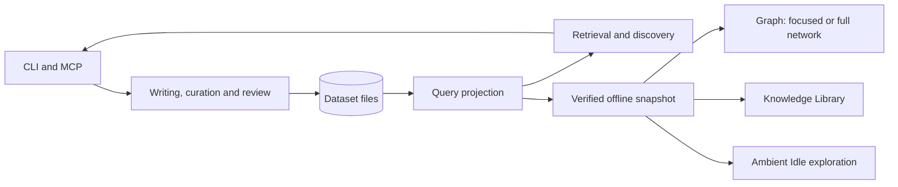

# Current architecture

KNOT is one Python application organised into feature packages. Local files hold
the authoritative knowledge; an in-memory Oxigraph store supplies a query view.
There are no separately deployed services or mandatory model providers.
An explicitly started loopback session can serve the Library editor; offline exports
and CLI/MCP workflows remain independently usable.

This diagram shows data flow, not every Python import. The complete storage
retention rules are in [datasets](datasets.md).

## Component ownership

All implementation paths are under `src/knot/`.

| Package | Responsibility |
| --- | --- |
| `writing/` | Dataset setup, note revisions, draft validation/publication, navigation, source projection and Git sync |
| `curating/` | Source pins, candidate validation/publication, preferred labels and evidence accounts |
| `reviewing/` | Assertion review events and their replay |
| `ingestion/` | Archive inventory, conversion and framework extraction |
| `graph/` | RDF vocabulary/helpers, query loading, organisation and theme review |
| `retrieval_engine/` | Retrieval coordination, graph/text search, discovery, selection and response budgets |
| `interfaces/` | CLI adapters, terminal authoring/curation workflows, MCP and source access grants |
| `presentation/` | Verified offline snapshots, Library/Graph renderers and legacy viewer |
| `diagnostics/` | Integrity/quality diagnostics and benchmark interfaces |
| `shared/` | Dataset/configuration resolution, hashing, atomic JSON writes, text extraction and vocabulary values |
| `_compat/` | Historical import and module-command aliases |

New internal code imports the canonical feature package. `_compat/` preserves
older public paths such as `knot.notes`; it is not an internal dependency layer.
Retrieval services coordinate engines; shared ranking, evidence and response code
must not depend on the coordinator merely to reuse a helper. Review replay is
separate from review writes. The architecture tests enforce selected boundaries.

### Workflow boundaries

`interfaces/console.py` owns terminal prompts. `authoring_cli.py` and `curation_cli.py`
coordinate interactive drafts through the existing writing and curation APIs.
`writing/authoring.py` retains draft validation, warnings and resumable publication;
`writing/curation_workflow.py` retains source selection data and provenance review
text. Their historical interactive entry points are thin, lazy compatibility
delegates. This boundary applies to these workflows, not every older CLI in KNOT.

The note CLI dispatches parsed commands to functions. The guided workflow uses a
small editor table while keeping publication, confirmation and recovery together.
Optional command modules remain lazily loaded.

`diagnostics/quality.py` runs ordered graph, note, evidence, semantic, association
and naming passes. `retrieval_engine/search.py` separates text revision selection,
verification, section extraction and scoring. Private dataclasses carry the shared
context; pass order, evidence policy, diagnostics and response budgets remain the
responsibility of the existing coordinators. These are direct function calls,
not plugin pipelines. See [ADR 0049](../design_decisions/0049-explicit-workflow-and-presentation-boundaries.md).

Synthetic test support lives under `tests/support/`; operational developer scripts
live under `scripts/`. Private experiment runners and outputs have been retired;
[ADR 0042](../design_decisions/0042-retire-experiments-and-export-tool-only.md)
summarises their outcomes and the code-only export boundary.

## Knowledge contracts

Notes have stable logical IDs and immutable, manifest-addressed revisions. Exact
body bytes live in content-addressed source snapshots. The registry records committed
membership; unreferenced files are not automatically published knowledge.

Each structured assertion has its own named graph and provenance. Origin, review
status, lifecycle and knowledge kind are distinct. Review events replay against
original assertion content before accepted identity mappings project canonical
endpoints. Presentation names and theme membership do not rewrite those assertions.

Retrieval filters permitted sources before ranking and traversal, verifies evidence,
and returns complete evidence packages under explicit budgets. Missing context is
reported as omissions. An MCP grant limits returned information; it is not an
operating-system sandbox for the local process.

## Dataset and presentation boundaries

Dataset paths are resolved at CLI boundaries from explicit arguments, environment
or user configuration. Core APIs continue to accept paths directly. Dataset setup
creates local files; Git is optional synchronisation using the same files. The
launcher preserves the caller's directory. See [ADR 0043](../design_decisions/0043-local-datasets-and-optional-git.md).
`shared/storage.py` owns the managed-path guard: resolve the selected root, reject
symlinks and traversal within it, and apply the same policy at read/write boundaries.
Setup and refresh also inspect managed path metadata. Explicit export destinations
remain independent of the selected dataset.
Graph loads and verification can repeat per request; no persistent search index or
whole-dataset transactional publication protocol has been introduced.

[ADR 0047](../design_decisions/0047-unified-knowledge-library-and-graph-exploration.md)
adds one offline snapshot opening in focused Graph View, with a Library button
for reading and browsing. `knot view` and `just visualise` open that single page;
`knot browse` keeps an export-only default. The old viewer remains available through
`knot view --legacy`.
The snapshot builder checks input signatures before and after verification and
publishes the completed HTML atomically; this is not a whole-dataset transaction.

### Library and Graph module boundaries

| Module | Responsibility |
| --- | --- |
| `interfaces/view_cli.py` | Shared launch entry point for `knot view` and `just visualise`, with explicit legacy selection |
| `interfaces/library_server.py` | Optional owner-local loopback session, fixed authenticated routes, ordinary-note create/save and verified snapshot refresh |
| `writing/examples.py` | Disposable synthetic datasets through the existing authoring APIs; shared by the CLI demo and tests |
| `presentation/library_snapshot.py` | Read projection through existing note, label, provenance and review owners; current/cited bodies, history metadata and input signatures |
| `presentation/note_records.py` | Verified current-note projection shared with the legacy viewer |
| `presentation/markup.py` | External sandboxed Pandoc conversion and inert HTML allowlist; no source mutation |
| `presentation/library.py` | Offline packaging, atomic publication and command coordination |
| `presentation/viewer_assets.py` | Verified bundled assets and complete software notices shared by both exporters |
| `presentation/browser.py` | Shared local/WSL browser launching |
| `presentation/graph_filters.js` | Existing pure graph filter semantics shared by both interfaces |
| `presentation/library_model.js` | Canonical indexes, search, virtual membership, routes and bounded traversal; no DOM |
| `presentation/library_dom.js` | Literal-text DOM helpers and pagination |
| `presentation/library_reader.js` | Readable notes, entities, pinned evidence, backlinks and review/history context |
| `presentation/library_graph.js` | One lazy vis-network instance, branch controls, stable positions and keyboard connection list |
| `presentation/library_graph_style.js` | Pure manual and Idle style strategies, including complete mode resets and per-frame fades |
| `presentation/library_layout.js` | Static coordinate spacing and optional network physics; the graph adapter pauses motion when hidden or reading, without changing knowledge |
| `presentation/library_idle_model.js` | Read-only excerpt selection, filtered tour policy, bounded visit history and a cancellable phase clock |
| `presentation/library_idle_scene.js` | Session geography, stable incremental placement, easing and bounded neighbourhood unions |
| `presentation/library_idle.js` | Focus/read/travel sequence, gradual neighbourhood fades, controls and visibility/full-screen handling |
| `presentation/library_navigation.js` | Route transitions, selection, browser history and saved manual context across Idle entry/exit |
| `presentation/library_authoring.js` | Optional modal editor, preview, draft/conflict handling and save/refresh separation |
| `presentation/library.js` | DOM composition, search/tree/reader controls and session-only recents |

[ADR 0048](../design_decisions/0048-idle-mode-autonomous-knowledge-exploration.md)
adds manually started Idle exploration. Graph and Idle share the graph adapter's
rendering function and one vis-network instance per window. Idle has its own traversal
and layout state; the navigation controller saves manual context through shell
callbacks on entry and restores it on exit.
Automatic steps bypass ordinary history and recents. Idle does not mutate the shared
knowledge model.

Offline browser modules consume the immutable exported model and never write
authoritative files. [ADR 0050](../design_decisions/0050-owner-local-library-authoring.md)
adds an explicitly enabled loopback editor using the existing note APIs. Its
session-only snapshot cache is rebuilt when inputs change; a successful save
refreshes the browser's model/indexes while retaining the selected canonical identity.
Exports contain no authoring capability. No database, framework, ontology or parallel
relationship store is introduced. [Synthetic example inputs](../data-examples/README.md) are shared by
the demo generator and tests; generated datasets remain outside the code checkout.

[ADR 0036](../design_decisions/0036-modular-retrieval-and-shared-boundaries.md) and
[ADR 0037](../design_decisions/0037-feature-packages-for-the-whole-application.md)
describe implemented boundaries. [ADR 0024](../design_decisions/0024-modular-local-first-knowledge-architecture.md)
contains broader proposals; its ports, indexes and publication changes are not an
implemented architecture. [Release preparation](release.md) tracks the public-release work.
